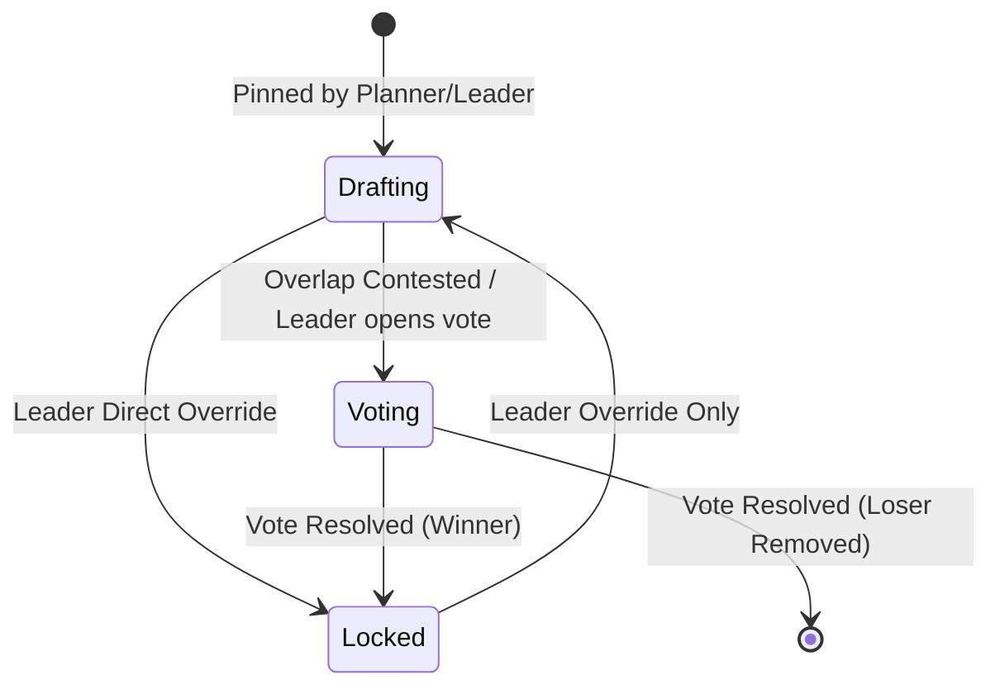

# AI Trip War Room: System Architecture

## 1. System Overview

The **AI Trip War Room** is a real-time collaborative itinerary canvas and group logistics engine designed for multi-traveler trip planning. It addresses high-concurrency group decision-making, deterministic hard constraint enforcement, and grounded AI recommendations.

```mermaid
flowchart TD
    ClientA["Browser Client A (Planner)"] <-->|WebSocket: /ws/trips/{id}| Gateway["Connection Gateway (Manager)"]
    ClientB["Browser Client B (Leader)"] <-->|WebSocket: /ws/trips/{id}| Gateway
    
    subgraph Backend ["FastAPI Backend Application"]
        Gateway <--> Board["In-Memory Room Board (Authoritative Mutex)"]
        Board -->|Dirty Flush (every 2s)| DB[(PostgreSQL / SQLite)]
        
        Gateway --> Log["Append-Only EventLog Table"]
        Log --> DB
        
        Gateway --> Conflict["Conflict Detector (Running Max-End Scan)"]
        Gateway --> Voting["Contested Slot Voting Engine"]
        Gateway --> Budget["Hamilton-Hare Budget Split Engine"]
        
        REST["REST API Routers (/auth, /trips, /venues, /admin)"] --> DB
        REST --> Reco["Hybrid Recommender Engine (0.5 Collab + 0.5 Content)"]
        REST --> AI["RAG AI Concierge Pipeline"]
        AI --> Filter["Deterministic Pure Constraint Matcher (40/30/30)"]
        AI --> LLM["Hosted LLM (2.5s Timeout + Honest Hedge)"]
    end
```

---

## 2. Real-Time Gateway & Authoritative In-Memory Board

### 2.1 State Management & Concurrency Control
- **In-Memory Board**: Each trip room maintains an authoritative `Board` instance in memory guarded by an asynchronous mutex (`asyncio.Lock`).
- **Optimistic Concurrency**: Every board item carries a strictly incrementing `position_version` (integer). When any planner attempts to move or edit an item, they submit their `seenVersion`.
  - If `seenVersion == item.position_version`: Mutation is applied, `position_version` is incremented by 1, and `trip.board.update` is broadcast to all participants.
  - If `seenVersion != item.position_version`: Concurrency conflict! The loser receives a targeted `trip.board.conflict` event with the latest server state, triggering an instant UI rollback toast.
- **Batched Persistence**: Mutations are marked `dirty` in memory and flushed to disk every 2 seconds by a background task, plus immediately upon item locking, vote resolution, and room closure.

### 2.2 Lifecycle State Machine
Itinerary items follow a strict lifecycle state machine:



### 2.3 Resiliency & Disconnect Rules
- **Snapshot Recovery**: Handshake delivers a full snapshot containing the active board, running integer-cent budget totals, participant presence, and recent chat tail. Clients resend nothing blindly upon reconnect.
- **10s Reconnect Grace**: If a socket disconnects, a 10s grace timer prevents emitting premature leave notifications if the user re-establishes connection immediately.
- **15s Leader Disconnect Rule**: If the trip leader disconnects, a 15-second grace countdown begins. If the leader does not return within 15 seconds, room lock/finalize and vote actions are frozen and broadcast to all participants until the leader returns.

---

## 3. Grounded AI Concierge & Pure Constraint Matcher

### 3.1 Strict Separation of Concerns
Constraints are **never delegated to the LLM prompt**. Hard rules are enforced deterministically in Python:
1. **Budget Ceiling**: `v.price_per_person <= req.ceiling`
2. **Dietary Union**: `req.dietary.issubset(set(v.dietary_tags))` (all dietary requirements across attending travelers must be satisfied)
3. **Hours with Buffer**: `v.open_min <= (req.slot_start - 30)` and `v.close_min >= (req.slot_end + 30)`
4. **Proximity**: `haversine_km(req.anchor, (v.lat, v.lng)) <= 2.0 km`

### 3.2 40/30/30 Ranking Formula
Valid candidates are scored and ranked:
$$\text{Score} = 0.4 \times \left(1 - \frac{d}{R}\right) + 0.3 \times \left(\frac{\text{Rating}}{5}\right) + 0.3 \times \left(\frac{\text{Ceiling} - \text{Price}}{\text{Ceiling}}\right)$$

### 3.3 Honest Hedge Guarantee
If zero candidates satisfy the group's constraints, the system runs `diagnose_elimination()` to identify which rule eliminated the highest number of venues (e.g. Budget vs Dietary vs Hours), and returns an honest hedge message advising the group which constraint to relax.

---

## 4. Integer-Cent Budget Split Engine

Floating point math introduces rounding drift (e.g. 10.00 split 3 ways yields 3.3333... summing to 9.99). The budget engine operates exclusively in integer cents using the **Hamilton-Hare Largest-Remainder Method**:
1. Base shares: $\lfloor \frac{\text{Total Cents} \times w_i}{\sum w} \rfloor$
2. Leftover cents: $\text{Total} - \sum \text{Base}$
3. Distribute leftover cents 1-by-1 to participants with the highest fractional remainder.
- **Guaranteed Invariant**: $\sum \text{shares} = \text{total\_cents}$ at all times.

---

## 5. Hybrid Recommendation Engine

Combines collaborative item-item cosine similarity with user feature centroids:
- **Feature Space**: 7 one-hot categories + 4 multi-hot dietary tags + normalized price.
- **Offline Evaluation**: 20% holdout test set per user achieves **Precision@5 $\ge$ 0.60** on synthetic Lisbon co-travel groups.
